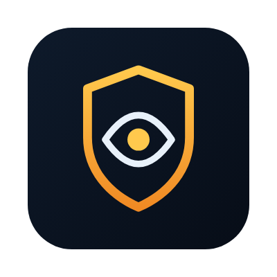

# Security Watch



Security Watch checks the dependencies of the project you have open for known vulnerabilities and
malicious packages, and says what to change: the package, the installed version, the fixed version
and the file it came from. It reads lockfiles and manifests for npm, Python, Go, Rust, PHP, Ruby,
Java, .NET, Dart, Elixir, Swift and Haskell, or any CycloneDX or SPDX SBOM, and checks the exact
versions against [OSV](https://osv.dev), marking entries in CISA's Known Exploited Vulnerabilities
catalog.

<!-- skills-only:
The plugin gives your coding agent two skills:

- `security-watch` tells the agent to check a package before adding it, check a dependency change
  before handing it back, and how to fix a finding without hiding it. It runs the
  `security-watch check` command line.
- `security-watch-setup` guides setting up the self-hosted monitor, which alerts on Slack or email
  when a new advisory affects software you run.

## Install

Upload this archive in the plugin directory, or install it from the Codex plugin directory. It
needs Node.js 24.10 or newer with npm, network access to api.osv.dev, and a host that runs local
programs (Codex, the ChatGPT desktop app).

## What it runs, reads and sends

- **Runs:** the skill tells the agent to run
  `npx --yes @shieldaai/security-watch@1.4.1 check <project>` from a temporary folder outside the
  project, so the project's `.npmrc` and `node_modules` cannot change which checker runs. Your
  host asks before running it, under the permissions you set. The package's
  `npm-shrinkwrap.json` fixes every dependency to the version that release was tested with.
- **Reads:** dependency files (lockfiles and manifests) under the project.
- **Sends:** package names, ecosystems and versions to OSV (`api.osv.dev`), and downloads CISA's
  public Known Exploited Vulnerabilities file. File contents never leave your computer, and
  nothing goes to Shielda. See [PRIVACY.md](PRIVACY.md).
- **Never:** runs project code or installs packages on its own.
-->
<!-- mcp:start -->

The plugin gives your coding agent two skills and an MCP server.

- **Skills:** `security-watch` tells the agent to check a package before adding it, check a
  dependency change before handing it back, and how to fix a finding without hiding it.
  `security-watch-setup` guides setting up the self-hosted monitor, which alerts on Slack or email
  when a new advisory affects software you run.
- **MCP server** with these tools:
  - `check_package`: a package version you are about to install, including OSV malicious-package
    records (typosquats, hijacked releases).
  - `check_dependency_change`: compares dependency files at a git ref (such as `HEAD`) with the
    working tree and reports only what the change brought in, and what it fixed.
  - `check_project_vulnerabilities`: every known vulnerability in the installed versions, most
    urgent first.
  - `check_advisory`: does CVE-X or GHSA-Y affect this project.
  - `list_dependencies`: files read, package counts, packages without an exact version.
  - `write_sbom`: a CycloneDX 1.6 SBOM inside the project. The only tool that writes.
  - `list_watch_findings`: open findings of your running Security Watch monitor, when you set
    `SECURITY_WATCH_CONFIG`.

## Example

After the agent adds `minimist@1.2.5` and upgrades `lodash`, it calls `check_dependency_change`
with `base: "HEAD"` and gets:

```text
Compared dependencies at HEAD (741f3abff1cc) with the working tree: 1 package added, 0 removed, 1 changed.
Added: npm:minimist@1.2.5
Changed: npm:lodash 4.17.20 -> 4.18.1

The change brings in 1 known vulnerability:
- [critical] npm minimist 1.2.5: Prototype Pollution in minimist (GHSA-xvch-5gv4-984h, CVE-2021-44906)
  Fix: upgrade to 1.2.6. In: package-lock.json. https://osv.dev/vulnerability/GHSA-xvch-5gv4-984h

It fixes 4:
- lodash: GHSA-35jh-r3h4-6jhm Command Injection in lodash
- lodash: GHSA-r5fr-rjxr-66jc lodash vulnerable to Code Injection via `_.template` imports key names
- lodash: GHSA-xxjr-mmjv-4gpg Lodash has Prototype Pollution Vulnerability in `_.unset`, `_.omit`, and `_.pullAt` functions
- lodash: GHSA-29mw-wpgm-hmr9 Regular Expression Denial of Service (ReDoS) in lodash
```

## Install

Claude Code:

```text
/plugin marketplace add ShieldaAI/security-watch
/plugin install security-watch@shielda-security-watch
```

Codex: `codex plugin marketplace add ShieldaAI/security-watch`, then install **Security Watch**
from the plugin directory in the app.

Antigravity CLI: `agy plugin install` with the path to this folder in a clone of the repository.

Any other MCP client: run `npx --yes @shieldaai/security-watch@1.4.1 mcp /path/to/project`, or
the container image (with signed build provenance)
`docker run -i --rm -v "$PWD:/project:ro" ghcr.io/shieldaai/security-watch:1.4.1 mcp /project`
(the image has no git, so `check_dependency_change` needs the npm form, and `write_sbom` needs a
writable mount).

It needs Node.js 24.10 or newer with npm, network access to api.osv.dev, and a host that runs
local programs: Claude Code, Codex, the ChatGPT and Claude desktop apps, Antigravity. In a chat
with no access to your files there is nothing for it to read.

To let the agent read your running monitor's findings, set `SECURITY_WATCH_CONFIG` to its
configuration file in the environment the host starts the server with; `list_watch_findings` then
appears. It reads the monitor's database and changes nothing.

## What it runs, reads and sends

- **Runs:** when a session starts, `scripts/start-mcp-server.mjs` runs
  `npx --yes --package=@shieldaai/security-watch@1.4.1 -- security-watch-mcp <project>` with npm
  from the same Node.js installation. The version is pinned and changes only with a new plugin
  version, and the package's `npm-shrinkwrap.json` fixes every dependency, sub-dependencies
  included, to the version that release was tested with. npx starts in the plugin's data folder
  (or a private temporary folder), not in the project, so the project's `.npmrc` and
  `node_modules` cannot change which checker runs; npm settings passed in environment variables
  (`npm_config_*`), `NODE_OPTIONS` and `NODE_PATH` are dropped too, and npm reads only your own
  `~/.npmrc`. If the host does not say which project is open and its working folder is `/` or
  your home folder, the server waits for the host to name the project (MCP roots) instead of
  reading the wrong place.
- **Downloads:** npm fetches the package from the registry in your own npm settings
  (`registry.npmjs.org` unless you changed it) the first time, then uses its cache. The package is
  open source: [ShieldaAI/security-watch](https://github.com/ShieldaAI/security-watch).
- **Reads:** dependency files (lockfiles and manifests) under the open project, git objects of
  those files when `check_dependency_change` compares with a commit, and, only with
  `SECURITY_WATCH_CONFIG`, your monitor's configuration and database. Nothing else.
- **Sends:** package names, ecosystems and versions to OSV (`api.osv.dev`) for each check, and
  advisory IDs to OSV for `check_advisory`. It downloads CISA's public Known Exploited
  Vulnerabilities file (`raw.githubusercontent.com`). With `epss: true`, CVE IDs go to FIRST
  (`api.first.org`). File contents, paths, notes and your monitor's data never leave your
  computer, and nothing goes to Shielda: no account, no telemetry. See [PRIVACY.md](PRIVACY.md).
- **Writes:** only `write_sbom`, to the path you name inside the project, and it refuses to
  replace an existing file unless asked. The other tools only read. When you ask the agent to fix
  a finding, it edits files with its own tools, under the permissions you already set.
- **Never:** runs project code, installs packages, changes settings, or changes your monitor's
  state (acknowledging, suppressing or reviewing findings stays in the `security-watch` command
  line, with a person deciding).

<!-- mcp:end -->

## Limits

A clean result means no advisory in OSV matches these versions today, not that the code is safe.
Packages without an exact version (a manifest with no lockfile) can only be checked by name.
Operating-system packages in a container SBOM are not matched; use your image scanner for those.
Read the [coverage and security limits](https://github.com/ShieldaAI/security-watch/blob/main/SECURITY.md).

## Support

[GitHub issues](https://github.com/ShieldaAI/security-watch/issues) or support@shielda.ai.
Apache-2.0, see [LICENSE](LICENSE).
